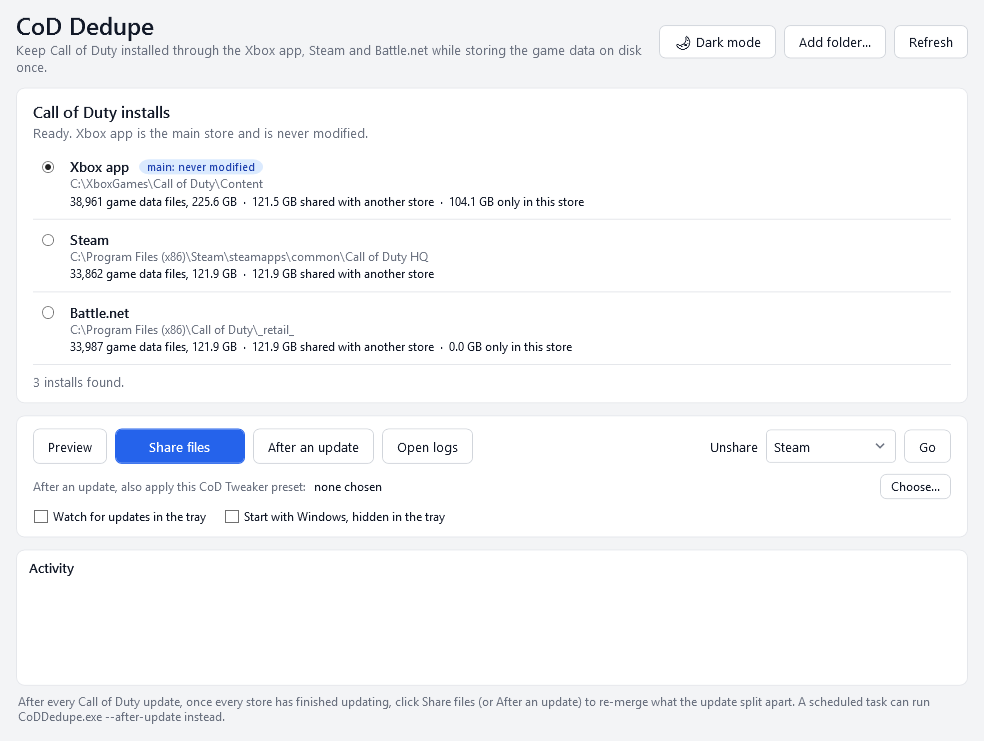

This tool is free, and will always be free. If you appreciate my work or tool, and feel like contributing, you can leave me a tip here: https://ko-fi.com/spocklsm

# CoD Dedupe

Keep Call of Duty installed through the **Xbox app, Steam and Battle.net** at the same time while storing the game data on disk **once**.



*Also in [dark](docs/screenshot-dark.png).*

COD Points stay on the store you bought them in, so some players keep CoD installed through more than one store. Each install is well over 100 GB, and almost all of it is the same files. CoD Dedupe finds your installs and makes them share one copy. Each store still sees a complete, normal install.

On the PC it was built on, three installs that would take about 470 GB use about 230 GB.

## How it works

Each store keeps its own install folder. The app finds game data files that are **byte-for-byte identical** across stores and turns them into NTFS [hard links](https://learn.microsoft.com/windows/win32/fileio/hard-links-and-junctions): one copy of the data on disk that appears as a real file in every store's folder.

- **You pick a main store.** Its files are never modified. The other stores' copies are replaced with links to it.
- **Only static game data is shared** (`.xsub`, `.xpak`, `.ff`, `.fp`). Executables, store files, shader caches and settings stay separate.
- **Nothing is linked without a full byte-by-byte compare first.** If one store is on a different patch, whatever differs keeps its own copy.
- **Hard links aren't shortcuts.** No store can tell the difference, and uninstalling one store leaves the other installs complete.
- **Cancel any time.** Each file is either linked or still a normal file; nothing is left half-done.
- **Light and dark**: follows your Windows setting, or pick one with the button in the corner.

## Requirements

- Windows 10 or 11. No admin rights needed.
- The installs must be on the **same drive**, because hard links can't cross drives. Installs on other drives are listed and left alone.
- An Xbox app install in a normal games folder (`XboxGames`), which is where the Xbox app installs games today. Installs inside the protected `WindowsApps` folder can't be shared.

## Use it

1. Download `CoDDedupe.exe` from the [latest release](../../releases/latest) and run it. Nothing to install.
2. Close Call of Duty, Steam, Battle.net and the Xbox app, and make sure nothing is downloading. The app tells you if any are still open.
3. Your installs are listed automatically. Pick your **main store**: the one you play from most.
4. **Preview** shows what would be shared without changing anything. **Share files** does it. The first run reads every file, which takes a few minutes per 100 GB.

> **Windows SmartScreen** may warn that the app is unrecognised, because it isn't code-signed. Click *More info > Run anyway*. The source is here if you'd rather build it yourself (see below).

### After every Call of Duty update

Updates can split shared files back into separate copies. That costs space but never breaks anything. Once **every** store has finished updating, open the app and click **Share files** again to merge them back.

If a store ever says files are damaged, run that store's repair, then share again:

- **Steam:** Properties > Installed Files > Verify integrity of game files.
- **Battle.net:** the cog next to Play > Scan and Repair.
- **Xbox app:** Manage > Files > Verify and repair.

This can happen when stores are on different patches and one of them updates a shared file in place.

### Undo

There's nothing to undo to keep things working: every store already has complete files. To give a store its own separate copies again, for example before moving it to another drive, pick it under **Unshare** and click **Go**. It needs free space equal to that store's shared data.

### Where things are kept

| | |
|---|---|
| Your main-store choice | `%LOCALAPPDATA%\CodSharedInstall\settings.json` |
| A log of every run | `%LOCALAPPDATA%\CodSharedInstall\logs` (the **Open logs** button) |

If an install isn't found, use **Add folder...** and pick its folder.

## FAQ

**Can this get me banned?** The app doesn't modify, patch or inject anything. Every game file keeps its exact original bytes; only how the files are stored on disk changes. Still, it isn't made or endorsed by Activision, so use it at your own risk.

**Why do Explorer and the store apps still show each install at full size?** They count every name of a file, so shared data is counted once per store. The real saving shows up in your drive's free space, and the app prints how much it freed.

**One store is a patch behind. Is that a problem?** No. Files that differ aren't linked, so each store keeps the version it needs. Update every store, then share again.

**Is my main store's install ever changed?** No. Only the other stores' folders are written to.

**My installs are on different drives.** Move one of them with its store's own move option so they're on the same drive, then click Refresh.

## How it finds your installs

| Store | Where it looks |
|---|---|
| Steam | Steam's install path in the registry, then every library in `libraryfolders.vdf`, then `appmanifest_1938090.acf` (the Call of Duty app) |
| Battle.net | Windows' installed-programs list (product code `auks`) and Battle.net's own `product.db`, then the `_retail_` game folder |
| Xbox app | Each drive's `.GamingRoot` marker (the Xbox app's library folders), then the game whose `MicrosoftGame.Config` names `38985CA0.COREBase` |

## Building it yourself

Needs the [.NET 10 SDK](https://dotnet.microsoft.com/download).

```
dotnet build CoDDedupe.slnx -c Release
dotnet test
```

To make the single-file exe that the releases ship:

```
dotnet publish src/CoDDedupe/CoDDedupe.csproj -c Release -r win-x64 --self-contained -p:PublishSingleFile=true -p:IncludeNativeLibrariesForSelfExtract=true -p:EnableCompressionInSingleFile=true -o publish
```

Releases are built by GitHub Actions: push a tag such as `v1.2.0` and the exe is attached to a release automatically.

The original PowerShell version of this tool is in [`legacy/`](legacy/) (tag `script-1.0`). It does the same job from a console and uses the same settings file.

## Disclaimer

Not affiliated with or endorsed by Activision, Microsoft, Valve or Blizzard. Call of Duty and the store names are trademarks of their owners. Provided as is, without warranty. See [LICENSE](LICENSE).
